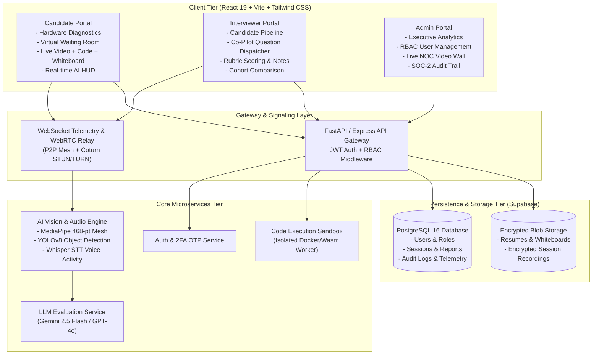
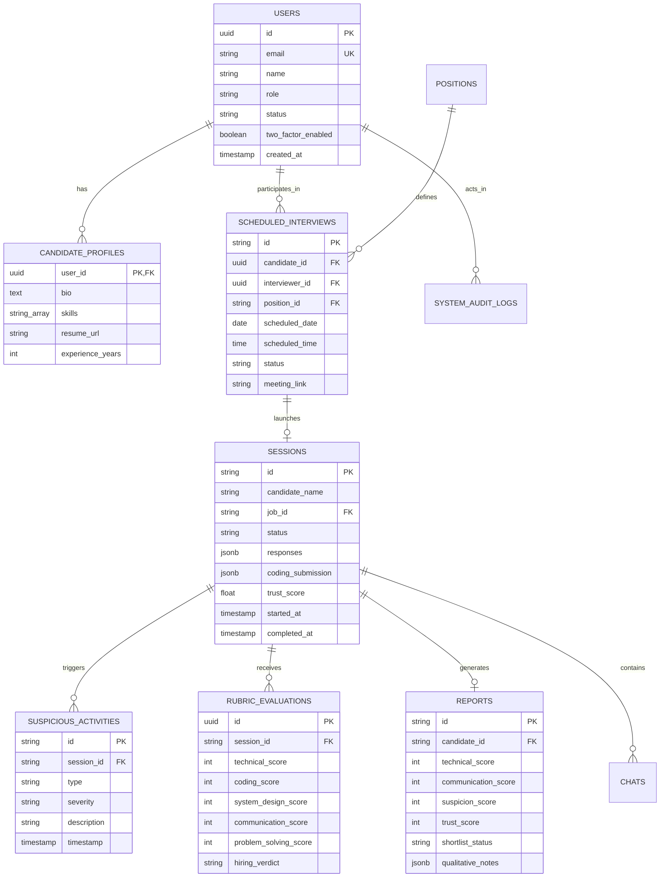
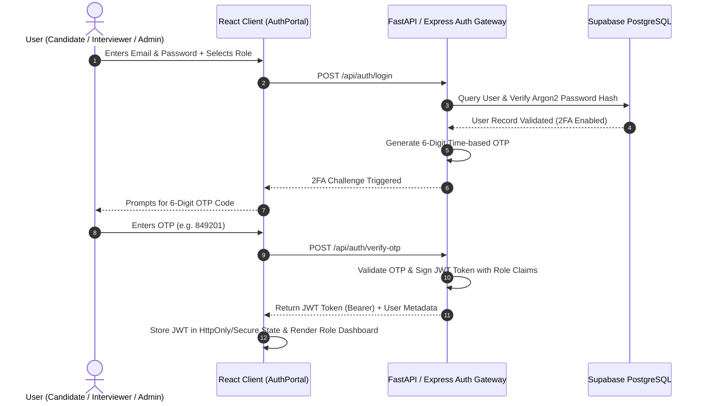
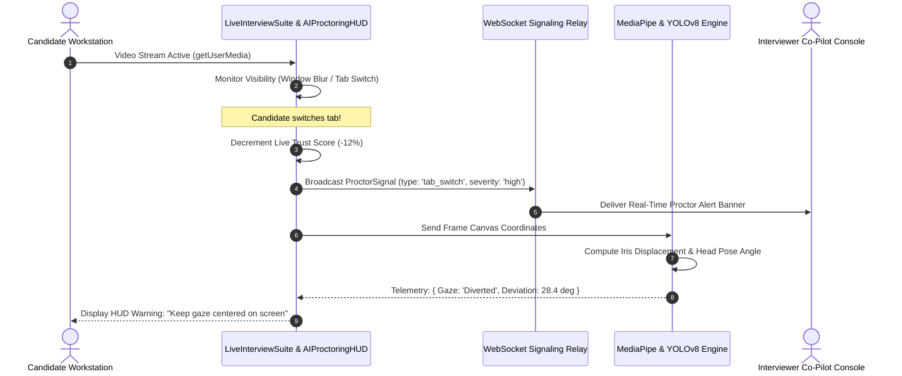

# HireShield AI Enterprise Technical Interview Platform
## Comprehensive Architecture & Engineering Specification

---

## 1. Project Architecture

HireShield AI is engineered as an enterprise-grade, distributed live technical assessment platform designed for high-concurrency video calling, real-time code compilation, collaborative whiteboarding, and multi-modal AI proctoring.



---

## 2. Folder Structure

```
hire/
├── backend/                        # Python FastAPI Backend
│   ├── ai/
│   │   ├── audio_analyzer.py      # Whisper STT & Voice Activity Detection
│   │   ├── evaluator.py           # LLM Rubric Evaluation Engine
│   │   ├── object_detector.py     # YOLOv8 Mobile Phone & Unauthorized Device Detector
│   │   └── vision_proctor.py      # MediaPipe FaceMesh & Eye Gaze Vector Estimator
│   ├── routers/
│   │   ├── admin.py               # RBAC User Management & Audit Logs
│   │   ├── auth.py                # JWT Auth, Signup, Password Reset & 2FA OTP
│   │   ├── candidates.py          # Resumes, Diagnostics, Scheduled Interviews
│   │   ├── interviews.py          # Live Room Lifecycle & Code Execution
│   │   └── reports.py             # Scorecard Generation & PDF Export
│   ├── main.py                    # FastAPI App & WebSocket Connection Manager
│   ├── models.py                  # SQLAlchemy Database Models
│   ├── requirements.txt           # Python Production Dependencies
│   └── schemas.py                 # Pydantic Request/Response Validation Models
│
├── src/                           # Frontend React 19 Client
│   ├── components/
│   │   ├── admin/
│   │   │   └── AdminPortal.tsx    # Analytics, User Management, NOC Wall, Audit Logs
│   │   ├── ai/
│   │   │   └── AIProctoringHUD.tsx# Real-time Gaze, Face Mesh, Trust Score HUD
│   │   ├── auth/
│   │   │   └── AuthPortal.tsx     # Login, Signup, Forgot Pass, OTP 2FA, Role Selector
│   │   ├── candidate/
│   │   │   ├── CandidatePortal.tsx# Candidate Hub & Tabs Navigator
│   │   │   ├── CodingEditor.tsx   # Syntax-highlighted Code Runner Sandbox
│   │   │   ├── DeviceDiagnostics.tsx # Real Camera, Mic Gain, Speed Test & Latency
│   │   │   ├── LiveInterviewSuite.tsx# Dual HD Video, Whiteboard, Code & Chat Room
│   │   │   ├── WaitingRoom.tsx    # Queue Position & Code of Conduct
│   │   │   └── WhiteboardCanvas.tsx # Collaborative HTML5 Drawing Canvas
│   │   ├── common/
│   │   │   └── ThemeToggle.tsx    # Dark / Light Mode Persistence Switcher
│   │   ├── interviewer/
│   │   │   └── InterviewerPortal.tsx # Pipeline, Co-Pilot, Rubric Scoring, Comparison
│   │   └── reports/
│   │       └── ReportsHub.tsx     # Printable PDF Scorecards & Question Breakdown
│   ├── mockData.ts                # Rich Enterprise Seed Data (Interviews, Challenges)
│   ├── supabaseClient.ts          # Supabase & REST API Integration Client
│   ├── types.ts                   # Universal TypeScript Domain Interfaces
│   ├── App.tsx                    # Top-Level Root Application & Role Router
│   ├── main.tsx                   # React DOM Entrypoint
│   └── index.css                  # Tailwind CSS Design System & Theme Directives
│
├── server.ts                      # Full-Stack Vite + Express Integration Server
├── supabase_schema.sql            # Complete Supabase PostgreSQL Schema & RLS Policies
├── package.json                   # Node.js Dependencies & Build Scripts
└── vite.config.ts                 # Vite Bundler Configuration
```

---

## 3. Database Schema (PostgreSQL / Supabase)

### Key Relational Entities:
1. **`users`**: Enterprise accounts with RBAC (`candidate`, `interviewer`, `admin`), department, and 2FA flags.
2. **`candidate_profiles`**: Linked to `users(id)`, storing verified skills array, bio, and resume download URLs.
3. **`positions`**: Job specifications with difficulty levels (`Junior`, `Intermediate`, `Senior`, `Lead`) and question banks.
4. **`scheduled_interviews`**: Calendar schedule linking candidates, interviewers, target roles, meeting links, and statuses.
5. **`sessions`**: Active interview rooms tracking question progression, code submissions, whiteboard snapshots, and trust score.
6. **`suspicious_activities`**: Proctoring audit flags (`tab_switch`, `multiple_faces`, `no_face`, `mobile_phone`, `copy_paste`).
7. **`rubric_evaluations`**: 5-point rubric grading submitted by interviewers (`technical`, `coding`, `system_design`, `communication`, `problem_solving`).
8. **`reports`**: AI synthesized evaluation scorecards, calculated final rank, and hiring recommendations.
9. **`chats`**: In-session instant messages with emergency indicators and file attachment references.
10. **`system_audit_logs`**: Immutable security trail of all administrative and authentication events.

---

## 4. API Endpoints Specification

### Authentication & RBAC
- `POST /api/auth/register`: Create user account with role selection.
- `POST /api/auth/login`: Authenticate corporate credentials and issue 2FA challenge.
- `POST /api/auth/verify-otp`: Validate 6-digit OTP code and return signed JWT access token.
- `POST /api/auth/forgot-password`: Dispatch password reset email with temporary OTP.

### Candidate & Pre-Flight
- `GET /api/candidates/interviews`: Retrieve candidate's upcoming scheduled rounds.
- `POST /api/candidates/diagnostics`: Log workstation hardware diagnostic results.
- `POST /api/candidates/resume`: Multipart file upload for PDF/DOCX resumes.
- `GET /api/candidates/scorecards`: Retrieve certified AI assessment reports.

### Live Interview & WebRTC
- `GET /ws/rooms/{session_id}`: Bi-directional WebSocket signaling for WebRTC, code sync, whiteboard drawings, and proctor alerts.
- `POST /api/sessions/{id}/execute-code`: Execute code in isolated sandbox and return stdout/stderr.
- `POST /api/sessions/{id}/whiteboard`: Save whiteboard canvas PNG snapshot.
- `POST /api/sessions/{id}/chat`: Post message to room with optional attachment.

### AI Proctoring & Telemetry
- `POST /api/proctor/telemetry`: Stream frame inference vectors (gaze angle, face count, YOLO detections).
- `POST /api/proctor/alert`: Record suspicious event (tab switch, mobile phone, copy-paste).

### Interviewer & Admin Oversight
- `GET /api/interviewer/pipeline`: List candidate interview pipeline and resume links.
- `POST /api/interviewer/rubric`: Submit structured 5-point rubric evaluation and hiring verdict.
- `GET /api/admin/analytics`: Return global KPIs, session volume, and trust score averages.
- `GET /api/admin/noc-streams`: Stream active live sessions for multi-tile monitoring wall.
- `GET /api/admin/audit-logs`: Paginated immutable SOC-2 audit logs.
- `PUT /api/admin/settings`: Update global proctor strictness and AI sensitivity thresholds.

---

## 5. UI/UX Wireframes

### Candidate Live Interview Suite Layout
```
+-----------------------------------------------------------------------------------+
| [Shield] HireShield AI  | MODE: CANDIDATE  | Timer: 44:18  | Wifi: HD | [End Session]|
+-------------------------+---------------------------------------------------------+
| [Interviewer Stream]    |  [Coding Editor] [Whiteboard] [Live Chat] [AI HUD]     |
|  +-------------------+  |  +---------------------------------------------------+  |
|  | Marcus Vance      |  |  Language: [TypeScript v]   [Run Tests] [Copy]        |  |
|  | Staff Lead        |  |  1: interface TelemetryQueue {                       |  |
|  | [Audio: Active]   |  |  2:   buffer: MalpracticeSignal[];                   |  |
|  +-------------------+  |  3:   flush(): MalpracticeSignal[];                  |  |
|                         |  4: }                                                |  |
| [Candidate Camera]      |  ---------------------------------------------------  |
|  +-------------------+  |  [STDOUT Terminal]                                   |  |
|  | Sarah Jenkins     |  |  > Test Case 1: Urgent priority bubbling... PASSED   |  |
|  | Trust Score: 96%  |  |  > Execution time: 14ms                              |  |
|  +-------------------+  +---------------------------------------------------+  |
| [Mic] [Cam] [Share]     | AI PROCTOR HUD: Face Verified ✓ | Eye Gaze: Center    |
+-------------------------+---------------------------------------------------------+
```

---

## 6. Figma-Style Design Tokens

```css
:root {
  /* Brand Primary Accents */
  --color-primary-50:  #eef2ff;
  --color-primary-500: #6366f1; /* Electric Indigo */
  --color-primary-600: #4f46e5;
  --color-primary-700: #4338ca;

  /* Secondary & Telemetry Accents */
  --color-teal-500:    #14b8a6; /* Live Audio Indicator */
  --color-emerald-500: #10b981; /* Integrity Verified */
  --color-amber-500:   #f59e0b; /* Gaze Warning */
  --color-rose-500:    #f43f5e; /* Malpractice Violation */

  /* Neutral Dark Mode Surfaces (Glassmorphic) */
  --surface-dark-bg:   #020617; /* Slate 950 */
  --surface-dark-card: rgba(15, 23, 42, 0.85); /* Slate 900 with blur */
  --surface-dark-border: rgba(51, 65, 85, 0.7);

  /* Typography */
  --font-heading: 'Outfit', -apple-system, sans-serif;
  --font-body:    'Inter', -apple-system, sans-serif;
  --font-code:    'Fira Code', 'JetBrains Mono', monospace;
}
```

---

## 7. Entity Relationship (ER) Diagram



---

## 8. Sequence Diagrams

### A. Authentication & 2FA Flow


### B. AI Proctoring & Live Telemetry Flow


---

## 9. AI Monitoring Workflow Details

1. **Facial Verification & Landmark Tracking**:
   - Computes 468 3D landmarks via MediaPipe FaceMesh every 200ms.
   - Extracts bounding coordinates of the iris relative to inner and outer eye corners.
   - Determines horizontal visual angle: if deviation > 22° for continuous 4.0 seconds, logs an `eye_gaze_diverted` flag.

2. **Multiple-Person Detection**:
   - Detects all human face bounding boxes in frame using Haar Cascades / SSD MobileNet.
   - If count > 1, immediately triggers high-severity alert: `multiple_faces_detected`.

3. **YOLOv8 Unauthorized Object Detection**:
   - Scans camera frame for mobile phone, headphone, or tablet objects using YOLOv8 nano model.
   - Dispatches instant proctor notice with frame timestamp.

4. **Speech-to-Text & Acoustic Analysis**:
   - Streams audio chunks through Whisper STT for live closed-captioning.
   - Measures ambient sound pressure level (dB): flags whispering or secondary conversational audio when candidate is not answering.

5. **Client-Side OS Sandbox Listeners**:
   - Intercepts `window.onblur`, `document.visibilitychange`, and `onpaste` clipboard operations.
   - Enforces fullscreen mode with automatic prompt to re-enter.

---

## 10. Production Deployment Runbook

- **Frontend**: Deployed to Vercel with automated GitHub integration, asset compression, and edge caching.
- **FastAPI Backend**: Dockerized multi-stage container deployed on Render / AWS ECS Fargate behind an Application Load Balancer with WebSockets support.
- **Database**: Hosted on Supabase Cloud (PostgreSQL 16) with Row Level Security (RLS), SSL connection pooling (PgBouncer), and automated daily backups.
- **WebRTC Signaling**: Coturn STUN/TURN server deployment on AWS EC2 to guarantee NAT traversal in corporate VPN environments.
